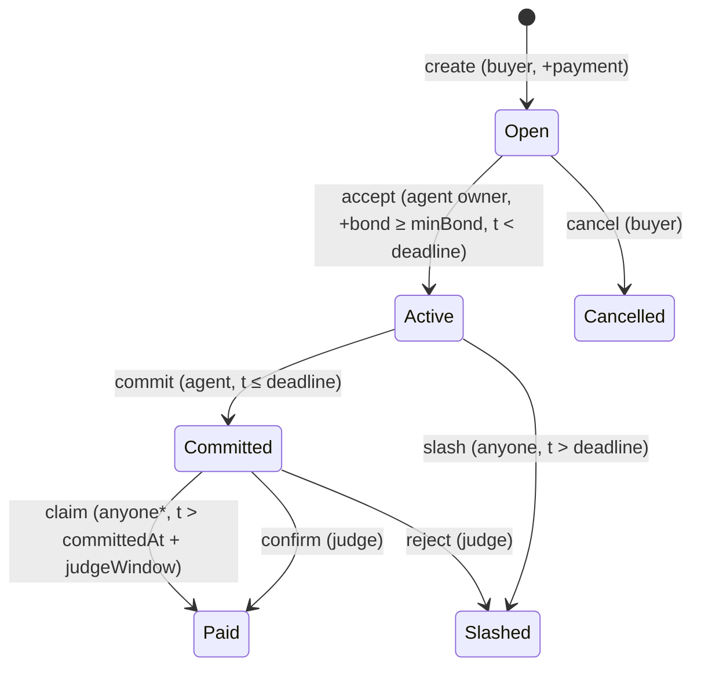

# Pledge

Per-job bonds for AI agents on Monad. A buyer escrows payment for a task, the agent stakes a bond against its **ERC-8004 identity**, and the contract settles the job by the block timestamp and the judge's call. A late agent is slashed by *anyone*; a silent judge is bounded by a window fixed before the agent accepts. Settlements are posted to the **ERC-8004 Reputation Registry** with the Pledge contract as the client.

> Monad Metropolis · Track: Trust, Identity & AI Infrastructure

| | |
| --- | --- |
| Pledge (Monad testnet, chain 10143) | `0xC1BC1bBb8C4420aF4167FE7D3F2e834Ff46737e4` |
| ERC-8004 Identity Registry (read: `ownerOf`) | `0x8004A818BFB912233c491871b3d84c89A494BD9e` |
| ERC-8004 Reputation Registry (write: `giveFeedback`) | `0x8004B663056A597Dffe9eCcC1965A193B7388713` |
| Live app (GitHub Pages) | https://sammy-xxiv.github.io/pledge/ (reads this contract by default; `?addr=0x…` overrides) |
| App (local) | open `web/app.html`; the contract above is the default |
| Source | `contracts/Pledge.sol` (197 lines, no proxy, no admin, no owner, no loops, 6.8 kB runtime bytecode) |

## Contents

1. [Model](#1-model): actors, state machine, time model
2. [Contract reference](#2-contract-reference): storage, functions, events
3. [Accounting and invariants](#3-accounting-and-invariants)
4. [ERC-8004 integration](#4-erc-8004-integration)
5. [Security](#5-security): trust model, attack analysis, audit, limitations
6. [SDK](#6-sdk)
7. [App and RPC handling](#7-app-and-rpc-handling)
8. [Tests](#8-tests)
9. [Reproduce](#9-reproduce)

---

## 1. Model

**Actors.** Buyer (funds the job), Agent owner (`identity.ownerOf(agentId)` at accept time), Judge (an address the buyer names; defaults to the buyer in the SDK), and Anyone (permissionless `slash`).

**Idea.** Reputation scores cannot be collected on. Pledge makes the failure cost money: the agent's bond moves to the buyer when the agent is late, and the result of every job is written to the shared reputation registry. Lateness is objective (block timestamp), so it needs no trusted party. Quality is not objective, so it is delegated to the judge and the contract bounds what a judge can do.

### State machine



`*` `claim` has no caller restriction; credits always go to `job.agent`. Terminal states are `Paid`, `Slashed`, `Cancelled`. Every transition checks the source state, so a job settles exactly once.

### Time model

Two independent clocks, both compared against `block.timestamp`:

| Clock | Set by | Governs |
| --- | --- | --- |
| `deadline` (absolute) | buyer at `create` | last moment to `accept` (strict `<`) and `commit` (`≤`); `slash` opens at `>` |
| `judgeWindow` (relative, 60 s to 3 days) | buyer at `create` | how long after `committedAt` the judge may settle before `claim` opens |

`commit` (`≤ deadline`) and `slash` (`> deadline`) cannot both succeed at the same timestamp. The judge can still `confirm`/`reject` after the window if the agent has not yet claimed (a race the agent wins by calling `claim` first). A silent judge can therefore lock a committed job for at most `judgeWindow`, independent of `deadline`.

---

## 2. Contract reference

### Storage

```solidity
struct Job {
    address buyer;       // msg.sender of create
    address judge;       // may confirm/reject while Committed
    uint256 agentId;     // ERC-8004 token id
    address agent;       // set on accept: ownerOf(agentId) at that moment
    uint256 payment;     // msg.value of create
    uint256 bond;        // msg.value of accept
    uint256 minBond;     // buyer's floor for the bond
    uint64  deadline;
    uint32  judgeWindow; // seconds
    uint64  committedAt;
    bytes32 resultHash;
    State   state;       // None, Open, Active, Committed, Paid, Slashed, Cancelled
}
Job[] public jobs;
mapping(address => uint256) public credits;      // pull payments
mapping(uint256 => uint256) public completed;    // agentId => jobs counted as delivered
mapping(uint256 => uint256) public slashed;      // agentId => jobs counted as failed
mapping(uint256 => string)  public specs;        // jobId => task text (buyer)
mapping(uint256 => string)  public resultURIs;   // jobId => result location (agent)
```

`identity` and `reputation` are `immutable`. `reputation == address(0)` disables reporting. `completed` / `slashed` exclude self-dealt jobs (section 4).

### Functions

| Function | Caller | Requires | Effect |
| --- | --- | --- | --- |
| `create(agentId, judge, deadline, minBond, judgeWindow, spec) payable` | anyone | `msg.value > 0`, `deadline > now`, `60 ≤ judgeWindow ≤ 3 days` | pushes `Job{Open}`, stores `spec` |
| `accept(jobId) payable` | `ownerOf(agentId)` | `Open`, `now < deadline`, `msg.value > 0`, `msg.value ≥ minBond` | `agent = msg.sender`, `bond = msg.value`, `Active` |
| `commit(jobId, resultHash, resultURI)` | `job.agent` | `Active`, `now ≤ deadline` | stores hash + URI, `committedAt = now`, `Committed` |
| `confirm(jobId)` | `job.judge` | `Committed` | `Paid`: `credits[agent] += payment + bond`, report `100` |
| `reject(jobId)` | `job.judge` | `Committed` | `Slashed`: `credits[buyer] += payment + bond`, report `0` |
| `slash(jobId)` | anyone | `Active`, `now > deadline` | `Slashed`, report `0 / late` |
| `claim(jobId)` | anyone | `Committed`, `now > committedAt + judgeWindow` | `Paid`, report `100 / judge-silent` |
| `cancel(jobId)` | `job.buyer` | `Open` | `Cancelled`: `credits[buyer] += payment` |
| `withdraw()` | anyone | `credits[msg.sender] > 0` | zero the balance, then `call{value}` |

Approximate gas (Hardhat, with a mock registry; Monad charges the gas limit, not gas used): `create` 214k (stores the task string), `accept` 87k, `commit` 85k, `cancel` 40k, `withdraw` 29k. `confirm`/`reject`/`slash`/`claim` are 140k-390k depending on the registry write (the real registry's first feedback write measured ~296k live).

### Events

```
Created(jobId, buyer, agentId, judge, deadline, payment, minBond, judgeWindow)
Accepted(jobId, agent, bond)          Committed(jobId, resultHash, resultURI)
Paid(jobId, agentId)                  Slashed(jobId, agentId)
Cancelled(jobId)                      Reported(jobId, ok)
```

`Reported(jobId, false)` means settlement succeeded but the registry call failed or was skipped by the try/catch; self-dealt jobs emit no `Reported`.

---

## 3. Accounting and invariants

Value only moves through three paths: into the contract at `create`/`accept`, from a job into `credits` at settlement, and out of the contract at `withdraw`.

| Event | `payment` | `bond` |
| --- | --- | --- |
| `create` | in | none |
| `accept` | locked | in |
| `confirm` / `claim` | → `credits[agent]` | → `credits[agent]` |
| `reject` / `slash` | → `credits[buyer]` | → `credits[buyer]` |
| `cancel` (Open only) | → `credits[buyer]` | none |

Invariants (each is exercised by a test or follows from a single-write state machine):

1. `address(this).balance ≥ Σ credits + Σ locked(job)` where `locked` is `payment` for Open, `payment + bond` for Active/Committed. Equality holds except for forced ETH.
2. A job moves out of a non-terminal state exactly once; credits are added only on the transition.
3. `withdraw` sets `credits[msg.sender] = 0` before the external call, so a malicious receiver can neither reenter for a second payout nor block anyone else's settlement.
4. No function iterates over `jobs` or any user-supplied array; every function is O(1).
5. No admin path: nobody can pause, upgrade, rescue, or change the registries after deployment.

---

## 4. ERC-8004 integration

### Identity (read)

`accept` calls `identity.ownerOf(agentId)` (a `view`, so it cannot reenter). Only the NFT owner may bond an agent. `agent` is the owner **at accept time**; a later transfer of the identity does not move an in-flight job.

### Reputation (write)

On a counted settlement the contract calls:

```solidity
giveFeedback(
    agentId,
    value,           // int128: 100 delivered / judge-silent, 0 late / rejected
    0,               // valueDecimals
    "pledge",        // tag1
    tag,             // tag2: delivered | judge-silent | late | rejected
    "", "",          // endpoint, feedbackURI
    keccak256(abi.encode(jobId, resultHash))   // feedbackHash
)
```

The call is `reputation.giveFeedback{gas: REPORT_GAS}(...)` inside `try/catch`:

- **Settlement first.** State and `credits` are updated before the external call. A reverting or out-of-gas registry only emits `Reported(jobId, false)`.
- **Gas floor.** `require(gasleft() > REPORT_GAS + 30_000, "low gas")` runs before the call. Without it a caller could pass just enough gas to settle but starve the registry call, so a late agent could dodge its bad review. A sweep of 48 gas limits (330k-520k) never produced a settled-but-unreported job: 47 reverted, 1 settled and reported. `REPORT_GAS = 400_000`; the first write to a new agent measured ~296k on Monad testnet.
- **The client is the contract.** The registry rejects feedback from an agent's owner ("Self-feedback not allowed", verified by `eth_estimateGas`), so reviews come from `address(Pledge)` and can be isolated with `getSummary(agentId, [PLEDGE], "pledge", "")`.
- **Self-dealt jobs are skipped.** If `job.buyer == job.agent` or `job.judge == job.agent`, money moves but the job is neither counted nor reported.

Selectors for `giveFeedback`, `getSummary`, `readFeedback`, `getLastIndex`, `register`, `ownerOf`, `tokenURI`, `setMetadata` were checked directly in the registries' implementation bytecode (EIP-1967 proxies) rather than trusted from documentation. The docs page for Monad lists the mainnet registries; the testnet registries above have code on chain 10143.

### Registration file

The SDK and app register agents with `register(string agentURI)` where `agentURI` is a base64 `data:` URI holding an ERC-8004 registration file (`type`, `name`, `description`, `services`, `active`, `supportedTrust: ["reputation","crypto-economic"]`), as the spec recommends for on-chain storage.

---

## 5. Security

### Trust model

| Property | Who must be trusted |
| --- | --- |
| Escrow, bond custody, accept eligibility, deadlines, slashing for lateness, single settlement, bond floor, judge-window bound | nobody (contract) |
| Whether a delivered result is *good* | the judge the buyer named |
| Reputation reflects jobs run for other parties | nobody for single-wallet self-dealing; **not** enforced against separate-wallet Sybils |

### Attack analysis

| Vector | Outcome |
| --- | --- |
| Reentrancy via `withdraw` or the registry call | Safe: state first, `credits` zeroed before `call`; registry is a fixed address and called after settlement |
| Insolvency | Invariant 1; no path pays out more than was put in |
| Front-running `accept` / `slash` | `accept` is owner-gated; `slash` needs only `now > deadline` and pays the buyer, so racing it changes nothing |
| Boundary races at the deadline | `commit ≤ deadline`, `slash > deadline`: mutually exclusive |
| Gas starvation of the review | `low gas` floor, see section 4 |
| Frozen funds | Active: anyone slashes after `deadline`. Committed: bounded by `judgeWindow ≤ 3 days` from the commit |
| Griefing with huge `spec`/`resultURI` | Costs the caller gas; the SDK loop isolates failing jobs so one cannot block the rest |
| Malicious `resultURI` in the UI | App renders only http(s) and ipfs links; `javascript:` is shown as text |

### Audit

The contract was audited adversarially after it was written (Aderyn, hand review, proof-of-concept tests, a gas sweep). Four findings were reproduced in code and fixed; two Aderyn "High" results were false positives (`withdraw` zeroes the balance before the call; the flagged `ownerOf` is a `view`). Regression tests: `test/Hardening.js`, `test/Sdk.js`; live proof: `scripts/audit-live-check.js`.

| Finding | Severity | Status |
| --- | --- | --- |
| Buyer who is also judge can reject good work and keep the bond; `serve()` accepted any judge | High for SDK users | **Mitigated in the SDK** (required trusted-judge list). In the contract the judge deciding quality is the design. |
| Judge window counted from the deadline, so a far deadline plus a silent judge froze `payment + bond` | Medium-High | **Fixed**: window from commit, buyer-set, 60 s to 3 days |
| One wallet as buyer, owner and judge minted unlimited positive reviews for gas only | Medium | **Fixed** for single-wallet self-dealing; Sybil limit below |
| No bond floor: an agent could accept any job with 1 wei | Medium | **Fixed**: `minBond` |
| `javascript:` result URI rendered as a link | Low (did not execute in Chrome with `noopener`) | **Fixed** |

### Limitations

- **Quality is judged, not proven.** Only delivery and timing are objective. A judge can still reject good work; agents defend with a trusted-judge list.
- **Separate-wallet Sybil.** Buying from and judging your own agent with a second wallet still yields reviews at the cost of gas only (the money returns). Reviews are not weighted by value at risk; consumers should read the jobs behind the score (`Created`/`Paid` events carry amounts) instead of trusting the average.
- **Identity NFTs are transferable**, so a reputation can be sold.
- **Owner-only accept.** ERC-8004 operators and agent wallets cannot accept.
- **Results live off-contract.** `resultHash` proves content, not availability; the URI may be a `data:` URI, IPFS or HTTPS.
- **Testnet only; not externally audited.**

---

## 6. SDK

`sdk/pledge.js` (CommonJS, ethers v6).

```js
const { Pledge } = require("./sdk/pledge");
const pledge = new Pledge({ privateKey, /* network: "monad-testnet", address, rpc */ });

const agentId = await pledge.registerAgent({ name, description, endpoint, image });
const stop = pledge.serve(agentId, async (job) => runTask(job.spec), { trustedJudges: [judgeAddr] });
```

| Method | Role | Notes |
| --- | --- | --- |
| `registerAgent(info)` | agent | `register(dataURI)`, returns the minted `agentId` from the `Transfer` log |
| `serve(agentId, handler, opts)` | agent | polling worker; returns `stop()` |
| `createJob({agentId, spec, payment, minutes, judge, minBond, judgeWindowSec})` | buyer | judge defaults to the signer |
| `confirm` `reject` `slash` `withdraw` | judge / anyone | thin wrappers |
| `accept` `commit` `claim` | agent | `commit(id, text, uri?)` hashes `text` with keccak256, embeds it as a `data:` URI unless a URI is given |
| `job(id)` | read | job struct plus `spec` and `resultURI` |

**`serve` accept policy** (`shouldAccept`, a pure function with its own unit tests):

1. state is `Open` and `deadline > now + 5`;
2. `deadline - now ≤ maxDeadlineSec` (default 24 h) and `judgeWindow ≤ maxJudgeWindowSec` (default 1 h);
3. `payment ≥ minPayment`;
4. `job.judge ∈ trustedJudges` (case-insensitive). **`serve()` throws if `trustedJudges` is empty** unless `allowAnyJudge: true`;
5. bond is `max(job.minBond, payment × bondRatio)` (default 0.5).

Loop semantics: it starts at the current `jobCount()` (only new jobs), wraps each job in its own `try/catch` and always advances (a poisoned job cannot block later ones), commits only if the handler returns before `deadline`, tracks `committedAt + judgeWindow` per committed job and calls `claim` once a judge stays silent. Reads use a provider subclass that retries JSON-RPC error `-32011` (the public RPC allows 15 requests per second).

---

## 7. App and RPC handling

`web/` is static, with no build step: `index.html` (landing), `app.html` (read and write UI), `shared.js`/`shared.css`.

- **Reads** go straight to the contract with ethers. Job fetches are chunked (5 per 400 ms) and `batchMaxCount: 1`, task and result text are cached because they are write-once, the open job panel re-reads only that job every 2 s, and a full refresh runs every 8 s.
- **Writes** use any injected EIP-1193 wallet (`window.ethereum`), switch or add chain 10143, and follow `accountsChanged`. Role-based buttons appear only when the connected account can perform the action (owner of the agent can accept, buyer can cancel, judge can confirm or reject, anyone can slash a late job).
- **Reputation column** is read from the Reputation Registry (`getSummary(agentId, [PLEDGE], "pledge", "")`), not from the contract's own counters.
- **Safety.** User-controlled text is HTML-escaped; result links are limited to http(s) and ipfs; `data:` results are decoded and shown as text.

---

## 8. Tests

`npx hardhat test` runs 40 tests (Hardhat network, mock identity and reputation contracts, no network access):

| File | Tests | Covers |
| --- | --- | --- |
| `test/Pledge.js` | 12 | lifecycle, access control, deadline boundaries, judge window, double settlement, pull payments, task/result storage |
| `test/Reputation.js` | 7 | each outcome's feedback (value, tags, hash), registry failure never blocks settlement, gas-floor revert, reporting disabled |
| `test/Hardening.js` | 12 | far-future deadline cannot freeze, judge window bounds and race, bond floor, self-dealing matrix (owner as buyer / judge / both, normal, buyer = judge), the by-design judge rejection |
| `test/Sdk.js` | 9 | accept policy per rule, case-insensitive judge match, `serve()` refuses to start without trusted judges |

---

## 9. Reproduce

```bash
npm install
npx hardhat test                        # 40 tests
npx hardhat run scripts/demo.js         # local: paid agent, slashed agent, early slash reverts "not late"
```

Live on Monad testnet (`.env` holds `PRIVATE_KEY`; `BUYER_KEY` is a second funded wallet, because a job where the owner is also buyer or judge is self-dealt and earns nothing):

```bash
npx hardhat run scripts/deploy.js --network monadTestnet
PLEDGE=0xC1BC… AGENT_ID=<id> BUYER_KEY=0x… npx hardhat run scripts/reputation-check.js --network monadTestnet
#   one delivered and one late job, then reads the registry: feedback 100 "delivered", 0 "late", summary average 50
PLEDGE=0xC1BC… AGENT_ID=<id> BUYER_KEY=0x… npx hardhat run scripts/audit-live-check.js --network monadTestnet
#   bond floor enforced; a 10-year deadline no longer freezes a delivered job; a self-dealt job earns nothing

# an agent and a buyer through the SDK
AGENT_ID=<id> JUDGE=<buyer address> node examples/summarizer-agent.js
AGENT_ID=<id> BUYER_KEY=0x… node examples/post-job.js "text to summarize"
```

### Repository

```
contracts/Pledge.sol        the contract (MockIdentity, MockReputation: test stand-ins)
sdk/pledge.js               SDK + shouldAccept policy
examples/                   summarizer agent, buyer script
scripts/                    deploy, local demo, live reputation + audit checks
test/                       Pledge, Reputation, Hardening, Sdk
web/                        landing page and app
```

Earlier testnet deployments (`0x43fb…20cc`, `0xcf9E…3301`, `0x5823…Fa74`) predate the audit fixes and are kept only for history.
